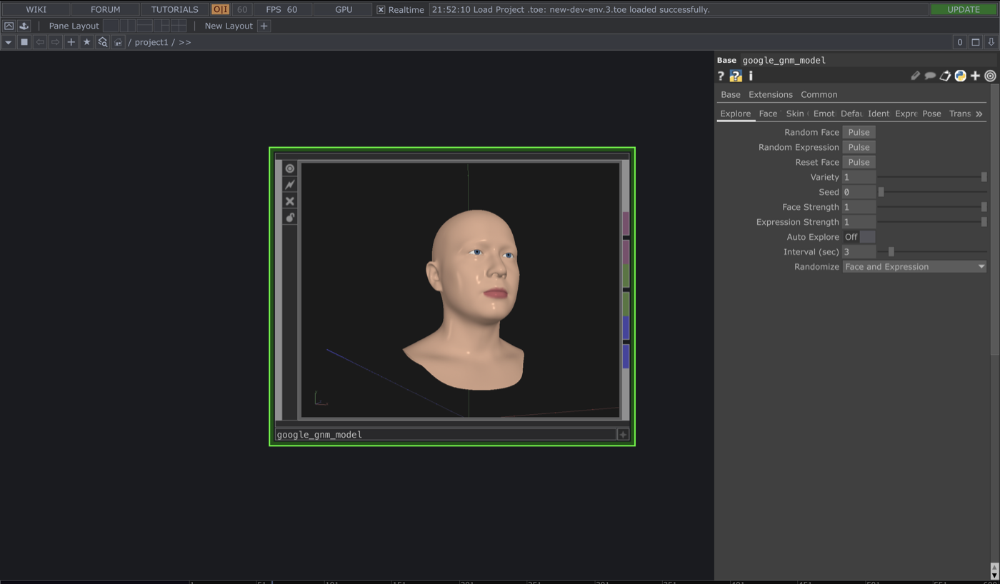
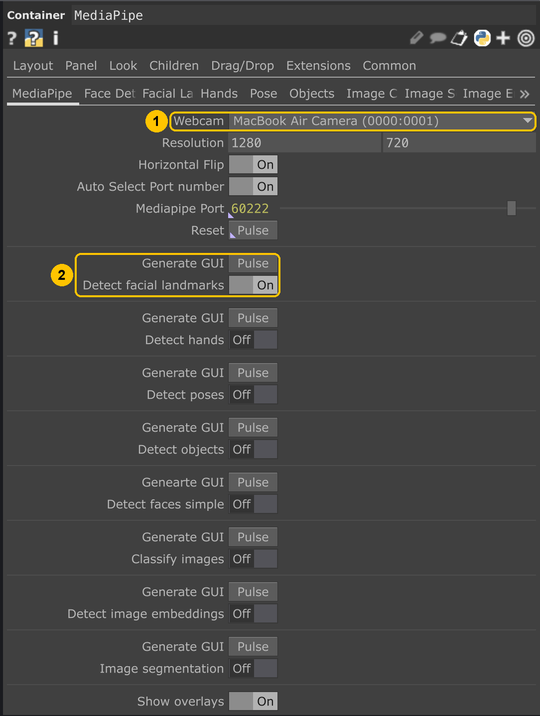
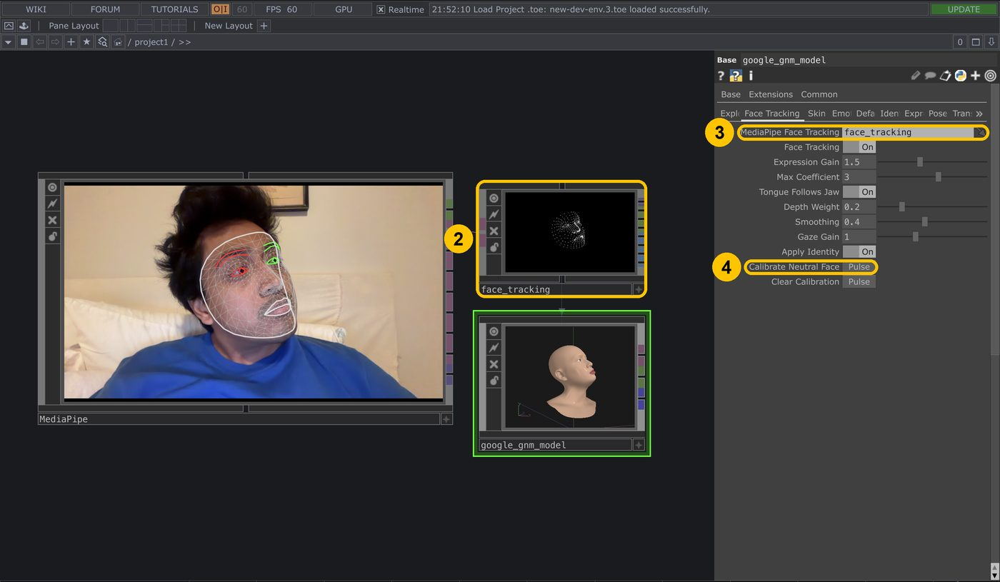

# GNM for TouchDesigner

[Google's GNM head model](https://github.com/google/GNM) as one drag-and-drop
TouchDesigner component: a realistic 3D head you can reshape, pose, color, and
drive with your own face from a webcam. Everything runs on the GPU.

Requires TouchDesigner 2025 or newer.

## Quick start

1. Drag `google_gnm_model.tox` into your project and wait a few seconds.
2. Select it and press **P**.
3. On the **Explore** page, press **Random Face**.

| Page | What it's for |
|---|---|
| **Explore** | Random faces and expressions, how wild they get, auto-explore on a timer |
| **Face Tracking** | Drive the head with your face (below) |
| **Skin Colors** | Colors for skin, lips, eyes, teeth and tongue |
| **Emotion Colors** | Tint the skin by the detected emotion |
| **Identity / Expression / Pose** | The model's own sliders, −3 … 3 |

## Face tracking

Uses [Torin Blankensmith's MediaPipe plugin](https://github.com/torinmb/mediapipe-touchdesigner).
Drag its `MediaPipe.tox` into your project, then:

1. On `MediaPipe`, pick your **Webcam**.
2. Turn on **Detect facial landmarks** and press the **Generate GUI** above it.
   This creates the `face_tracking` component, already wired to MediaPipe.
   The other detectors can stay off.

3. On the head's **Face Tracking** page, set **MediaPipe Face Tracking** to
   that `face_tracking` component.
4. Relax your face and press **Calibrate Neutral Face**.

## Outputs

1. The head (POP, with point colors)
2. `emotion_out` (CHOP): neutral, happy, surprise, angry, sad, fear and `dominant_id`
3. `emotion_label_out` (DAT): the current emotion as text

## Good to know

- Emotion detection reads facial movement, not feelings. It's a rough
  heuristic; don't use it to judge people.
- GNM was trained on limited demographic categories; see Google's
  [fairness notes](https://github.com/google/GNM/blob/main/gnm/shape/README.md).

## Credits

Model data: [Google GNM](https://github.com/google/GNM), Apache 2.0 (see
`LICENSE` and `NOTICE.md`). Face tracking input:
[MediaPipe TouchDesigner](https://github.com/torinmb/mediapipe-touchdesigner)
by Torin Blankensmith (MIT, installed separately). TouchDesigner integration by
Isaac, Apache 2.0. Not affiliated with Google or Derivative.
